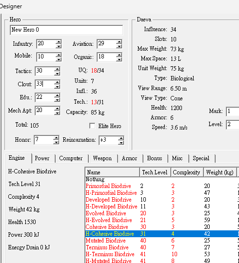

# 指揮官狀態欄位（Commander Status）

依《戰術指揮官》（Tactical Commanders）Everzone #101 的
「指揮官屬性資訊（戰略, 政治, 知識, 技術）」章節，用原生 JavaScript
製作的即時狀態面板。

規則以 **A（Everzone #101）** 為底，並與 **B（龍傲天下提供）**
四項規則逐條對照；兩者不一致處在程式中標明採用版本。
頁面可直接開啟，不需要安裝套件、不需要 build，也不需要啟動伺服器。
版面參考舊式 Designer 工具介面。

## 快速開始

直接開啟 [commander.html](commander.html) 即可。

也可以從 [index.html](index.html) 的「指揮官狀態」導覽進入。

若要用本機 HTTP 伺服器預覽：

```powershell
cd tc_units_zh
python -m http.server 8000
# 開啟 http://localhost:8000/commander.html
```

頁面使用傳統 `<script>` 載入，沒有 ES module 的 `file://` CORS 限制。

## 功能

- 戰略、政治、知識、技術四項指揮官屬性輸入
- 單位等級、基礎體力、基礎重量、基礎空間、貢獻度、回歸次數、對手政治輸入
- 即時計算並顯示：
  - 實戰體力
  - 科技等級
  - 升級指數
  - 單位重量
  - 單位空間
  - 持有單位數
  - 本國戰場人員數
  - 戰鬥投入單位數（上限 12）
  - 敵軍兵種可見性
- 9 個示範單位模板，可直接改基礎數值
- 下方公式表同步顯示「公式／目前代入／結果」
- 一鍵重置、複製目前狀態 JSON

## 介面參考



此截圖僅供版面與欄位配置參考；圖中的單位數值不是本頁的計算資料。

術語對照（兵種等級 vs 能力、Mobile ≠ Mech Apt 等）見 [COMMANDER_TERMS.md](COMMANDER_TERMS.md)。

## 檔案結構

```text
tc_units_zh/
├─ README.md                     # 本文件
├─ commander.html                # 指揮官狀態頁
├─ index.html                    # 單位資料庫首頁（已加入導覽）
├─ css/
│  └─ commander.css              # 面板樣式與響應式版面
├─ js/
│  ├─ commander-core.js          # 公式、輸入正規化、單位模板
│  ├─ commander-ui.js            # DOM 綁定與畫面更新
│  └─ commander-core.test.cjs    # Node.js 公式測試
└─ images/
   └─ designer-reference.png     # 版面參考截圖
```

## 公式來源

主要來源：

- [Everzone #101：戰術指揮官 單位規格](https://everzone.tistory.com/101)
  - 原文日期：2025-07-31
  - 目標章節：〈指揮官屬性資訊（戰略, 政治, 知識, 技術）〉
- 本地中文翻譯：
  [everzone/posts-zh/101-戰術指揮官-單位規格.md](../everzone/posts-zh/101-戰術指揮官-單位規格.md)
  - 翻譯：`qwen36-35b-a3b`
  - 結構審閱：`structural_pass`
- 韓文原文：
  [everzone/posts/101-택티컬-커맨더스-유닛-스펙.md](../everzone/posts/101-택티컬-커맨더스-유닛-스펙.md)

協同／競爭規則 B：

- **龍傲天下**（2026-10-23 由使用者提供，無公開 URL）
- 四項規則原文見下一節，僅作為對照與補正，不改寫 A 的原始條目。

輔助參考：

- [Everzone #146：指揮官升級所需經驗值](https://everzone.tistory.com/146)
  （與指揮官養成相關，但目前頁面沒有使用經驗值公式。）
- [Everzone #101 單位表](https://everzone.tistory.com/101)
  （頁面內 9 個示範單位的基礎體力、基礎重量、基礎空間與分類來源。）

> #101 也註明部分價格、空間與重量資訊來自舊版資料；實際遊戲數值可能隨版本變動。

## A / B 規則對照

### A：Everzone #101

- **戰略**：1 點使單位基礎體力 +3。
- **科技等級**：單位等級 + 知識/3 + 技術/10。
- **升級指數**：單位等級 + 知識/3。
- **重量（空間）**：基礎重量（空間）×（1 + 技術/120）。
- **持有單位**：24 + 政治/5，基礎上限 48；回歸 +2/次，最多 12 次。
- **本國戰場人員**：10 + 領主戰略/8。
- **戰鬥投入單位**：6 + 戰略/20。
- **可見性**：中文譯文寫「對方政治值比自己高 10 以上」；韓文原文則是
  「比對手政治高 10 以上」，兩者方向相反，於下方對照表處理。
- **貢獻度**：1 萬 = 生命值 +1%。

### B：龍傲天下（使用者提供）

1. **戰術能力**：影響上場帶兵量；每 20 點多帶 1 支，最多 12 支上陣。
   補充：每多 1 點增加 3 點體力。
2. **政治聲望**：影響兵的存放；每 5 點多放 1 支。
   補充：比別人多 10 點以上，可按 F2 在戰場簡介看到別人所帶兵種；
   每多 1 點也會得到更多金錢。
3. **教育水準**：影響單位素質及技術；每 3 點素質及技術 +1。
4. **技術能力**：影響單位技術、負重和空間；每 10 點技術 +1。
   - 可裝備重量 = 單位基本重量 ×（1 + MECH APT/120）
   - 可裝備空間 = 單位基本空間 ×（1 + MECH APT/120）

### 對照結果

| 項目 | A | B | 目前採用 |
| --- | --- | --- | --- |
| 體力 | 戰略 +3/點 | 戰術 +3/點 | 一致 |
| 上陣台數 | `6 + floor(戰略/20)`，未封頂 | 每 20 點 +1，最多 12 | 保留 A 的基礎 6，加上 B 的 12 台上限 |
| 持有單位 | `24 + floor(政治/5)`，上限 48，回歸另計 | 每 5 點 +1，未提上限 | 保留 A 的基礎、上限與回歸；B 確認 5:1 |
| 政治情報 | 中文翻譯寫成「對方政治比自己高」 | **自己比別人高 10 以上**，F2 看兵種 | 採 B；並依韓文原文修正方向 |
| 教育 | 知識/3 進入科技與升級指數 | 每 3 點素質／技術 +1 | 一致；「素質」映射到升級指數 |
| 技術 | 技術/10 進入科技；重量倍率 1+技術/120 | 每 10 點 +1；重量與空間各自計算 | 一致；本頁補上獨立空間 |
| 政治金錢 | 未提供公式 | 每多 1 點金錢增加 | 無公式與基準值，暫不實作 |
| F2 顯示 | 只描述可見性 | 按 F2 查看對方兵種 | 頁面文案說明；不模擬遊戲快捷鍵 |

> **重要修正：可見性方向。**
> A 的中文翻譯是「若對方政治值比自己高 10 以上」，但韓文原文
> `상대방보다 정치가 10이상 높으면` 的意思是「比對手高 10 以上」，
> B 也明確寫「比別人多 10 點以上」。因此程式改為
> `ownPolitics - opponentPolitics >= 10`，舊版實作的方向是錯的。

## 公式與實作

核心計算位於
[js/commander-core.js](js/commander-core.js)
的 `calculate()`。

| 狀態欄位 | A／B 採用規則 | 本專案實作 |
| --- | --- | --- |
| 實戰體力 | 戰略 1 點使單位基礎體力 +3；貢獻 1 萬 = 生命值 +1% | `floor((baseHp + strategy * 3) * (1 + contribution / 100))` |
| 科技等級 | 單位等級 + 知識/3 + 技術/10 | `unitLevel + floor(knowledge / 3) + floor(technology / 10)` |
| 升級指數 | 單位等級 + 知識/3 | `unitLevel + floor(knowledge / 3)` |
| 單位重量 | 基礎重量 × (1 + 技術/120) | `baseWeight * (1 + technology / 120)` |
| 單位空間 | 基礎空間 × (1 + 技術/120) | `baseSpace * (1 + technology / 120)` |
| 持有單位數 | 基礎 24 + 政治/5，基礎上限 48；回歸 +2/次，最多 12 次 | `min(48, 24 + floor(politics / 5)) + returns * 2` |
| 本國戰場人員 | 基礎 10 + 領主戰略/8 | `10 + floor(strategy / 8)` |
| 上陣台數 | 基礎 6 + 戰略/20，最多 12 | `min(12, 6 + floor(strategy / 20))` |
| 敵軍兵種可見性 | 我方政治 ≥ 對手政治 + 10 | `politics - opponentPolitics >= 10` |
| 貢獻度 | 貢獻 1 萬 = 生命值 +1% | `contributionPct = contribution`（輸入單位為「萬」） |

### 取捨與假設

1. **整數除法**
   #101 沒有明講 `知識/3`、`技術/10` 等除法的小數處理方式。本頁採分項向下取整，
   因為遊戲中的等級與指數以整數顯示。若原始碼其實是先加總再取整，只需調整
   `calculate()` 內的 `Math.floor` 位置。

2. **貢獻加成順序**
   先加上「戰略 × 3」的體力，再套用貢獻百分比，最後向下取整。

3. **持有單位上限**
   將「最大 48 台」視為政治的基礎上限；回歸 12 次、每次 +2 另計，
   因此含回歸最高為 `48 + 24 = 72` 台。若你要把 48 當成總上限，
   請調整 `BASE_HOLDING_CAP`、`MAX_RETURNS`、`RETURN_UNITS` 三個常數。

4. **領主戰略**
   「本國戰場人員」原文採領主戰略。本頁只有一位指揮官，因此暫以目前指揮官的
   戰略代入；頁面下方有相同註記。

5. **重量與空間**
   B 明確把重量與空間寫成兩條公式；兩者各自使用自己的基礎值，但共用
   `1 + 技術/120` 倍率。例如基礎重量 75、基礎空間 60、技術 120，
   結果會是 150 kg 與 120 L，而不是同一個數字。

6. **可見性方向**
   可見性以「我方政治 − 對手政治 ≥ 10」實作，並在畫面提示可按 F2 查看
   對方交戰兵種。這一項是本次對照中最重要的修正。

7. **B 尚未實作的部分**
   - 政治每點增加金錢：B 沒有提供基準值、公式或上限，暫不納入。
   - F2 快捷鍵：頁面只呈現「達成條件後可見兵種」的資訊，不模擬遊戲按鍵。
   - 「單位素質」：A 沒有獨立數值，暫以「升級指數」承接 B 的描述。

8. **單位資料範圍**
   頁面只內建 9 個示範單位，並非完整單位資料庫；完整清單請見 #101。

## 測試

不需要安裝任何測試套件：

```powershell
cd tc_units_zh
node js/commander-core.test.cjs
```

目前包含 11 項測試，涵蓋：

- 預設值
- 戰略對體力的加成
- 貢獻度百分比
- 知識／技術的整數除法
- 政治換算與持有上限
- 回歸次數
- 戰場人員與上陣台數
- B 規則的 12 台上陣上限
- B 規則的重量／空間分離計算
- 我方政治高出對手 10 點的可見性門檻
- 輸入範圍正規化

預設狀態的畫面輸出為：

- 實戰體力：1,290
- 單位重量：87.5 kg
- 單位空間：87.5 L
- 科技等級：11
- 升級指數：9
- 持有單位：30 台
- 上陣台數：7 台
- 公式列：9 列

## 核心 API

`commander-core.js` 同時支援瀏覽器與 Node.js。

瀏覽器：

```js
const result = CommanderCore.calculate({
  strategy: 30,
  politics: 33,
  knowledge: 22,
  technology: 20,
  unitLevel: 2,
  baseHp: 1200,
  baseWeight: 75,
  baseSpace: 75,
  contribution: 0,
  returns: 0,
  opponentPolitics: 30,
});

console.log(result.hp.effective);     // 1290
console.log(result.tech.level);       // 11
console.log(result.weight.effective); // 87.5
console.log(result.space.effective);  // 87.5
console.log(result.deployment);       // 7（上限 12）
```

Node.js：

```js
const { calculate } = require('./js/commander-core.js');
const result = calculate({ strategy: 30, politics: 33 });
```

## 製作資訊

- 協助工具：DeepSeek Harness AI 編碼代理
- 平台標示：DeepSeek V4.1（使用者標示）
- 本會話模型識別：`deepseek-flash`
- 整理日期：2026-10-23

> 平台版本名稱與內部路由模型識別可能不同；本文件如實記錄兩者，實際版本以平台顯示為準。

### Token 用量快照

統計時間：2026-10-23 21:21（Asia/Taipei）  
統計範圍：建立 `commander.html` 與本 README 初版的兩個工作回合，包含工具呼叫與中介步驟。

| 工作回合 | API 呼叫 | 非快取輸入 | 輸出 | 快取讀取 | 合計 |
| --- | ---: | ---: | ---: | ---: | ---: |
| 頁面實作 | 61 | 41,314 | 78,039 | 4,915,968 | 5,035,321 |
| README | 9 | 4,585 | 8,640 | 1,136,128 | 1,149,353 |
| **合計** | **70** | **45,899** | **86,679** | **6,052,096** | **6,184,674** |

> 上表是 provider 回報的 token 計數加總，包含每次模型呼叫重讀的系統提示、工具定義與快取上下文；
> 不等同文章字數。實際費用需依快取命中與平台單價計算，請以帳單為準。
> 此快照不包含後續對話，也不包含 A/B 規則對照與空間欄位的更新。

## 資料來源與權利聲明

> 本文件為玩家自製的非官方整理，與《戰術指揮官》（Tactical Commanders，TCR）之開發商、營運商、發行商及其關係企業無隸屬、代理、贊助、背書或授權關係。

### 權利歸屬

- 《戰術指揮官》之遊戲名稱、商標、角色、單位、圖像、介面、文字及其他遊戲內容，其著作權與相關智慧財產權歸 Nexon、TCR 官方及／或其他原權利人所有。
- Everzone 網站之文章、圖片與原文內容，著作權歸 Everzone 作者所有。本文件僅引用、翻譯、整理並標註來源，不主張其著作權。
- 規則 B 由「龍傲天下」提供；本文件僅整理、對照並標明差異，不主張原創。相關內容如涉及第三人權利，仍歸各該權利人所有。
- 本目錄之原創程式碼與中文整理文字，除另有註明外，由本文件作者享有著作權；上開權利主張僅限原創部分，不及於遊戲原始資料、圖片或第三方內容。

### 使用範圍與免責

- 本文件僅供個人研究與非商業性遊玩參考，不構成官方攻略、官方意見或任何形式之授權。
- 本文件不保證內容即時、完整或正確；若數值與遊戲內實際顯示不同，以遊戲版本、官方公告及原始文章為準。
- 遊戲規則與官方內容之解釋，以 TCR／Nexon 官方最新公告及原始文章為準；本文件不主張對遊戲規則或官方內容之最終解釋權。
- 所有遊戲圖片、商標與素材之權利均屬原權利人所有，本文件僅作說明與辨識用途。如權利人認為有不當使用，請透過本專案聯絡管道告知，將儘速處理或移除。
- 本文件作者保留修改、更新本文件編排與說明文字之權利；惟不影響原權利人依法主張之權利。
